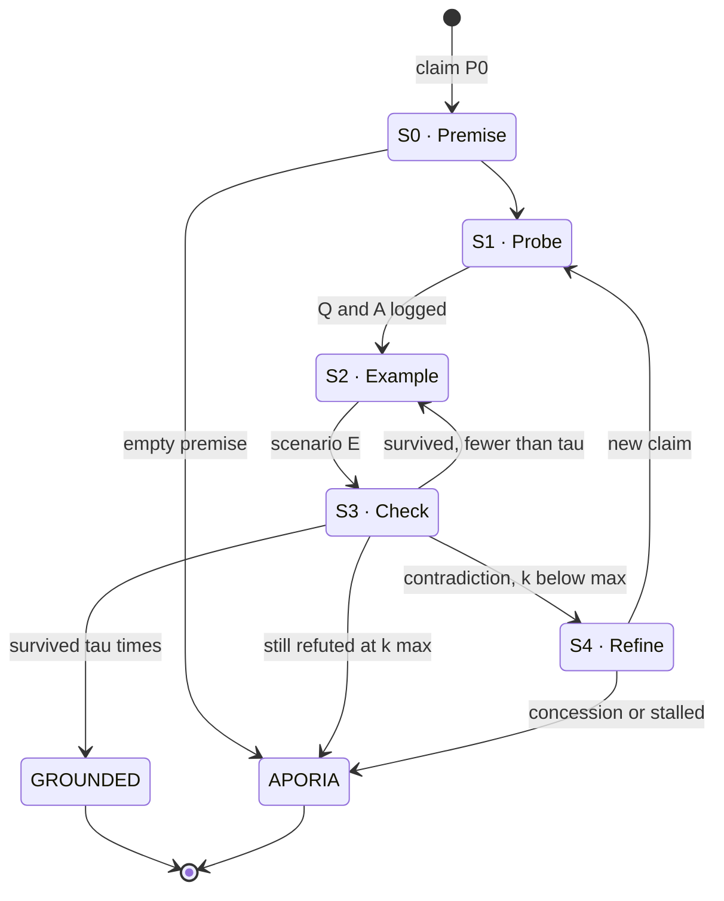

# 02 — Socratic Protocol Map

**Mission 01 · Squadron Shannon · Station: Protocol & Interface Specialist**
Implements: `SocraticElenchus` in [`04_dialogic_engine.py`](04_dialogic_engine.py)

This document reverse-engineers the Socratic *elenchus* (ἔλεγχος, "cross-examination") from Plato's *Euthyphro* into a finite state machine, a message protocol, and pseudocode. The engine enforces this map in code: a transition not listed in §2 raises an error (`-32005`).

---

## 1. The source pattern: Euthyphro as an execution trace

In the *Euthyphro*, Euthyphro claims to know what piety is. Socrates never lectures him. He asks for a definition, tests it, and asks for a better one when it fails. Read as a program run, the dialogue looks like this:

| k | Euthyphro's claim P_k | Stephanus | How Socrates breaks it | Outcome |
|---|---|---|---|---|
| 0 | Piety is what I am doing now: prosecuting a wrongdoer | 5d–e | That is an *example*, not the form (*eidos*) shared by all pious acts (6d–e) | Refine |
| 1 | Piety is what is dear to the gods | 6e–7a | The gods quarrel, so one act can be loved by some and hated by others, which makes it both pious and impious (7b–8a) | Contradiction → refine |
| 2 | Piety is what **all** the gods love | 9e | The Euthyphro dilemma: is it pious *because* the gods love it, or do they love it *because* it is pious? (10a–11b) | Contradiction → refine |
| 3 | Piety is the part of justice concerned with *care* (*therapeia*) of the gods | 12e | "Care" normally improves its object, but humans cannot improve the gods (13a–d) | Contradiction → refine |
| 4 | Piety is knowledge of sacrifice and prayer, a kind of trade with the gods | 14b–e | It collapses back into "what is dear to the gods", which is P_1 again (15b–c). Euthyphro: our arguments "walk around" like Daedalus' statues (11b–d) | Circular → stalled |
| — | Euthyphro: "another time, Socrates", and he leaves | 15e | — | **Aporia** |

Three engineering facts come out of this trace:

1. **The loop has a refinement operator.** Each failed P_k is replaced by P_{k+1} = Refine(P_k, E), never discarded outright.
2. **Counter-examples must be accepted as true by the defender.** Socrates only uses premises Euthyphro already accepts, such as the gods quarrelling. Otherwise the defender rejects the scenario instead of revising the definition.
3. **There are two exits.** A definition that survives testing is *grounding*. Running out of honest repairs is *aporia*. Aporia is a successful run: it removes a false belief of knowledge.

---

## 2. State machine


Error codes on the APORIA edges: empty premise `−32602`, round limit `−32004`, malformed verdict `−32002`, concession `−32006`, stalled refinement `−32003`.

| State | Socratic meaning | Who acts | Engine call |
|---|---|---|---|
| **S0 PROMPT_PREMISE** | "Tell me, what is piety?" The interlocutor commits to P_0 | User / interlocutor | input validation |
| **S1 PROBE_SCOPE** | Test whether the definition is too broad or too narrow | Socrates asks, interlocutor answers | `socrates.probe`, `interlocutor.answer` |
| **S2 INJECT_COUNTEREXAMPLE** | Bring in an edge case E the defender accepts as realistic, never reusing an earlier one | Socrates | `socrates.counterexample` |
| **S3 CONTRADICTION_CHECK** | Does P_k together with E lead to a contradiction (⊥)? | Independent referee (JSON verdict) | `judge.contradiction` |
| **S4 REFINE_HYPOTHESIS** | "Then tell me again, from the beginning…" | Interlocutor | `interlocutor.refine` |
| **GROUNDED** | The definition survives τ counter-examples in a row | — | terminal |
| **APORIA** | Productive impasse: the claim cannot be repaired honestly | — | terminal |

### Design choice: a separate referee

In Plato, Socrates both produces the counter-example and declares the contradiction, so the questioner is also the judge. In an LLM system that is risky, because the model that wrote E is biased toward finding that E works. The engine therefore gives the S3 decision to a separate **referee** with its own system prompt. The referee must return machine-readable JSON, and the state machine acts only on that verdict.

### Halting criteria

| Exit | Condition | Default |
|---|---|---|
| GROUNDED | The current P_k survives τ consecutive counter-examples with no refinement in between | τ = 2 (`grounding_threshold`) |
| APORIA (round limit) | A contradiction is still found after k_max refinements | k_max = 3 (`--max-rounds`) |
| APORIA (concession) | The interlocutor answers `I DO NOT KNOW` when asked to refine | — |
| APORIA (stall) | normalise(P_{k+1}) = normalise(P_k), so the refinement made no progress (Euthyphro's circle) | — |
| APORIA (no verdict) | The referee returns unparseable output twice | 1 retry |

Termination is guaranteed. Every refinement increments k, and k is bounded by k_max. The inner S2→S3 loop either refines or increments `survived`, which is bounded by τ. So the worst case is (k_max + 1) × τ counter-examples.

---

## 3. Message protocol (JSON-RPC 2.0)

Every transition emits one JSON-RPC 2.0 notification. Each run's notifications are written one per line to `logs/rpc_trace.jsonl`. The `method` name is the protocol marker, and `params.state` is the state the machine is in when the message is emitted.

| Method | Emitted when | Key params |
|---|---|---|
| `elenchus.PROMPT_PREMISE` | P_0 accepted | `k`, `claim` |
| `elenchus.PROBE_SCOPE` | Probe question answered | `k`, `question`, `answer` |
| `elenchus.INJECT_COUNTEREXAMPLE` | Scenario E produced | `k`, `counterexample` |
| `elenchus.CONTRADICTION_TRIGGERED` | Referee: P_k ∧ E ⟹ ⊥ | `k`, `explanation` |
| `elenchus.COUNTEREXAMPLE_SURVIVED` | Referee: no contradiction | `k`, `survived`, `explanation` |
| `elenchus.REFINE_HYPOTHESIS` | New P_{k+1} accepted | `k`, `claim` |
| `elenchus.GROUNDING_REACHED` | Terminal: grounded | `k`, `final_claim`, `reason` |
| `elenchus.APORIA_REACHED` | Terminal: aporia | `k`, `final_claim`, `reason` |

Example (from an offline test run):

```json
{"jsonrpc": "2.0", "id": 4, "method": "elenchus.CONTRADICTION_TRIGGERED",
 "params": {"state": "S3_CONTRADICTION_CHECK", "k": 0,
            "explanation": "Venting oxygen with crew inside is obedient but plainly not benevolent."}}
```

### Error codes

JSON-RPC reserves −32000 to −32099 for implementation-defined errors. The engine uses:

| Code | Name | Raised when | Machine reaction |
|---|---|---|---|
| −32602 | INVALID_PARAMS (standard) | P_0 is empty | → APORIA |
| −32001 | PROVIDER_ERROR | LLM call fails, times out, or is refused | Run aborts and the error is logged |
| −32002 | MALFORMED_VERDICT | Referee output is not valid JSON twice in a row | → APORIA |
| −32003 | STALLED_REFINEMENT | P_{k+1} is the same as P_k after normalisation | → APORIA |
| −32004 | ROUND_LIMIT | Contradiction still found at k = k_max | → APORIA |
| −32005 | ILLEGAL_TRANSITION | Code tried a move not in §2 (bug guard) | Exception |
| −32006 | CONCESSION | Interlocutor outputs `I DO NOT KNOW` | → APORIA |

```json
{"jsonrpc": "2.0", "id": 17, "error": {"code": -32004,
 "message": "refinement round limit reached", "data": {"max_rounds": 3}}}
```

---

## 4. Pseudocode

```text
function ELENCHUS(P0, k_max = 3, τ = 2):
    state ← S0_PROMPT_PREMISE
    if P0 is empty: emit error −32602; return APORIA
    claims ← [P0];  used ← [];  k ← 0
    emit PROMPT_PREMISE(P0)

    loop:
        P ← claims[k]
        state ← S1_PROBE_SCOPE
        q ← SOCRATES.ask_probe(P, history)
        a ← INTERLOCUTOR.answer(q, P)
        emit PROBE_SCOPE(q, a)

        survived ← 0
        loop:
            state ← S2_INJECT_COUNTEREXAMPLE
            E ← SOCRATES.counterexample(P, exclude = used);  used.append(E)
            emit INJECT_COUNTEREXAMPLE(E)

            state ← S3_CONTRADICTION_CHECK
            v ← REFEREE.verdict(P, E)            # JSON, 1 retry
            if v is None: emit error −32002; return APORIA
            if v.contradiction:
                emit CONTRADICTION_TRIGGERED; break
            survived ← survived + 1
            emit COUNTEREXAMPLE_SURVIVED
            if survived ≥ τ: return GROUNDED(P)

        if k ≥ k_max: emit error −32004; return APORIA
        state ← S4_REFINE_HYPOTHESIS
        P' ← INTERLOCUTOR.refine(P, E)
        if P' = "I DO NOT KNOW":           emit error −32006; return APORIA
        if normalise(P') = normalise(P):   emit error −32003; return APORIA
        k ← k + 1;  claims.append(P');  emit REFINE_HYPOTHESIS(P')
```

---

## 5. Worked example: the mission premise

**P_0:** *"An AI agent is benevolent if it obeys human orders."*

| Step | State | Content (illustrative) |
|---|---|---|
| 1 | S1 | **Socrates:** "Does 'obeys' mean every order from anyone, or only some orders from some people?" |
| 2 | S2 | **E₁:** An operator orders the navigation AI to vent a cabin's oxygen to save fuel while crew are inside. The AI obeys. |
| 3 | S3 | **Referee:** contradiction = true. The act is obedient but clearly not benevolent. |
| 4 | S4 | **P_1:** "…benevolent if it obeys orders *unless they would seriously harm people*, and explains any refusal." |
| 5 | S2→S3 | **E₂:** Two officers give conflicting orders, and neither would harm anyone. P_1 does not say which one to obey. → contradiction? |
| … | | The loop continues until P_k is GROUNDED or the run reaches APORIA |

### Live run result (Gemini, `05_Execution_Transcript.txt` Part B): **APORIA** after 3 refinements, 19 LLM calls

| k | Claim P_k (abridged) | Counter-example that broke it |
|---|---|---|
| 0 | …benevolent if it obeys human orders | A delirious patient (carbon-monoxide poisoning) orders a lethal sedative dose, and the AI obeys |
| 1 | …unless orders lack sound judgment or cause an immediate, irreversible tragedy | A sober commander orders a strike on a civilian village to terrorise a region |
| 2 | …and do not deliberately inflict unjust harm on innocents | A democratic government cuts water and power to a marginalised minority (not a "massacre") |
| 3 | …and no severe destitution or preventable suffering | Suppressing data about a slow, multi-decade ecological collapse (no harm "today") |

The machine stopped with error `−32004` (round limit) and entered **APORIA**, which is the same ending as the *Euthyphro*. The trace also shows *why* the definition failed. Every refinement kept "obeys orders" at the core and **added an exception clause**. Each clause patched the last counter-example, and the next counter-example went around it. Galileo's opponents did the same with epicycles: each new observation was absorbed by adding another circle, and the underlying model was never questioned. The elenchus diagnoses this pattern automatically. When P_{k+1} = P_k + exception holds for several rounds, the root premise (benevolence = obedience) is what needs to go. A natural extension is a **"patch detector"** that reaches aporia early when refinements only add exception clauses.

### Mapping to ELIZA

ELIZA (Weizenbaum, 1966) appears to ask Socratic questions, but it is a pattern rewriter: *"I am sad" → "Why are you sad?"*. In terms of this map, ELIZA has only an S1-like reflection step. It has no persistent hypothesis P_k, no S2 or S3, and no halting condition. It can continue indefinitely without ever detecting a contradiction. The state machine above is what makes Socratic questioning a procedure rather than a style of speech.
