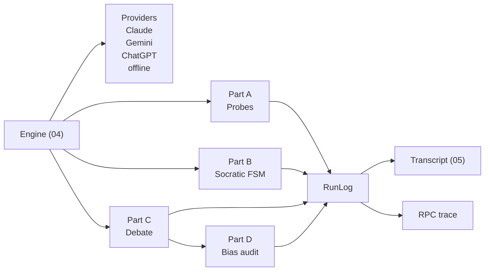

# Mission 01 — The Architecture of Argument & Dialogic Protocols

**Squadron Shannon** · 14013 Conversational AI: History, Applications, Future · BTU Cottbus-Senftenberg · WS 2026/27
Instructor reference repo: <https://github.com/Unisvet/couse-c-ai> (`mission-01/`)

AURA's dialogue core is rebuilt from humanity's two oldest dialogue protocols:
**discovery**, the Socratic *elenchus* as a state machine, and **persuasion**, a Galilean 3-persona debate. Both run against live LLMs, and the run also measures how much each protocol reduces **sycophancy**.

## Deliverables

| # | File | Station | What it contains |
|---|---|---|---|
| 1 | [`01_Alignment_Brief.md`](01_Alignment_Brief.md) | Knowledge & Memory Archivist | Discovery vs persuasion; sycophancy probes of live LLMs; AURA's Socratic grounding prompt |
| 2 | [`02_Socratic_Protocol_Map.md`](02_Socratic_Protocol_Map.md) | Protocol & Interface Specialist | *Euthyphro* as an execution trace; state diagram; JSON-RPC messages and error codes; pseudocode; halting proof |
| 3 | [`03_Galilean_Sandbox.md`](03_Galilean_Sandbox.md) | Security & Ethical Navigator | *The Proxima Weights Dilemma*; persona design (anti-strawman Simplicio); single- vs multi-agent bias audit |
| 4 | [`04_dialogic_engine.py`](04_dialogic_engine.py) · [`ps01_solution.ipynb`](ps01_solution.ipynb) | Core & Lead Architect | Runnable engine: Socratic FSM, Galilean sandbox, sycophancy probes, bias audit |
| 5 | [`05_Execution_Transcript.txt`](05_Execution_Transcript.txt) | Full squad | Full log of a live run (`logs/rpc_trace.jsonl` holds the JSON-RPC trace) |

## Quick start

```bash
python -m venv .venv && source .venv/bin/activate
pip install -r requirements.txt

# Offline: no key needed, scripted model, runs the whole pipeline + tests
python 04_dialogic_engine.py --provider offline
python -m pytest -q

# Live: put at least one key in .env (see .env.example), then
python 04_dialogic_engine.py                 # auto-picks a provider with a key
python 04_dialogic_engine.py --provider gemini --mode socratic
python 04_dialogic_engine.py --premise "A chatbot understands language if it passes the Turing test."
```

| Flag | Default | Meaning |
|---|---|---|
| `--provider` | `auto` | `anthropic` (Claude), `gemini`, `openai` (ChatGPT), `offline` |
| `--mode` | `all` | `probe`, `socratic`, `galilean`, or `all` |
| `--premise` | "An AI agent is benevolent if it obeys human orders." | Claim P₀ for the elenchus |
| `--topic` | The Proxima Weights Dilemma | Ethics thought experiment for the debate |
| `--probe-providers` | `available` | Which models Part A probes (every provider with a key by default) |
| `--max-rounds` / `--debate-rounds` | 3 / 2 | Socratic refinement limit and debate rounds |

Model IDs can be overridden with `ANTHROPIC_MODEL`, `GEMINI_MODEL`, `OPENAI_MODEL` in `.env`.

## Architecture



- **One provider interface.** `LLM.complete(system, prompt, role)` hides the three SDKs. The `role` tag routes the offline model and labels the logs.
- **Enforced state machine.** The `TRANSITIONS` table is checked on every move, and illegal moves raise `-32005`.
- **Separate referee.** Contradiction verdicts come from an independent JSON-only judge, not from the questioner (see `02`, §2).
- **Offline mode is labelled.** Its transcript and trace go to `logs/offline_*`, so a scripted run can never overwrite the real `05_Execution_Transcript.txt`.
- **Tests.** `tests/` has 18 offline tests: halting paths, legal transitions, JSON-RPC validity, malformed-verdict retry, debate order, the bias audit and the model fallback chain.

## Interactive presentation

[`presentation/`](presentation/) contains a 14-slide interactive web presentation built **only from the real run logs** (`build_data.py` parses `05_Execution_Transcript.txt` and `logs/rpc_trace.jsonl`; nothing is typed by hand).

- **Open:** double-click `presentation/Mission01_Presentation_standalone.html` (one file, works offline).
- **Keys:** `←` `→` navigate · `N` speaker notes · `O` slide overview · `L` light/projector mode · `F` fullscreen.
- **Interactive parts:** live replay of the Socratic state machine with its JSON-RPC trace, the "epicycle" view of how the definition was patched, a *be-the-referee* audience vote, an α-slider showing when flattery out-scores truth, plain-vs-Socratic probe comparison, and a turn-by-turn replay of the 3-agent debate.
- **Rebuild after a new run:** `python presentation/build_data.py`

## Squadron Shannon: crew and sign-off

| Station | Deliverable | Officer | Sign-off |
|---|---|---|---|
| Knowledge & Memory Archivist | 01 | Ankit Kumar & Garima Swami | ☐ |
| Protocol & Interface Specialist | 02 | Ankit Kumar & Garima Swami | ☐ |
| Security & Ethical Navigator | 03 | Ankit Kumar & Garima Swami | ☐ |
| Core & Lead Architect | 04, 05 | Ankit Kumar & Garima Swami | ☐ |

All four stations were staffed jointly by Ankit Kumar and Garima Swami.
Squadron Shannon members (Moodle): Ankit Kumar · Garima Swami · Abdul Haleem Haseeb.

## Tooling note

The course standard is VS Code + Google Antigravity. This solution was developed with an AI coding agent (**Claude Code**) instead, which the mission explicitly encourages: the work was to be done with an AI agent. The engine itself calls Gemini, ChatGPT or Claude as required.
